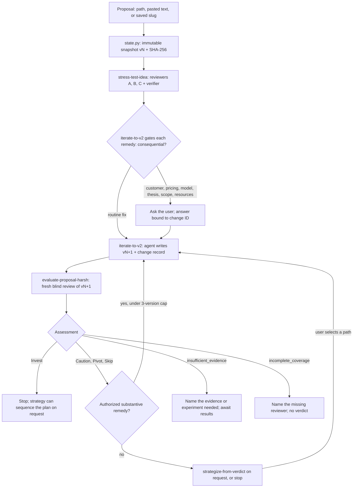
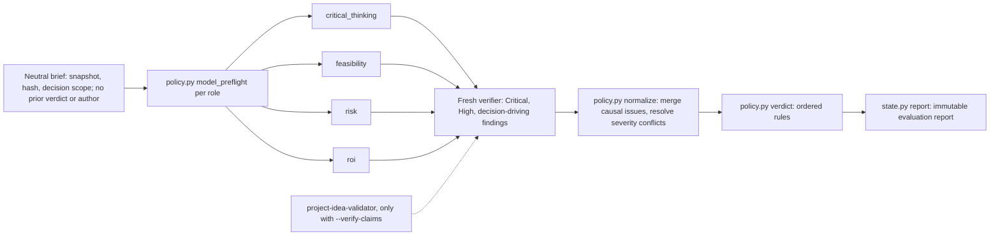

# Idea Autopsy

**An evidence-gated, multi-agent review of product and business proposals for Claude Code. It reports what your evidence supports, asks before changing anything consequential, and writes the next version itself.**

[](.claude-plugin/plugin.json)
[](LICENSE)
[](https://code.claude.com/docs/en/plugins-reference)
[](skills/_shared)

---

## The problem

If you ask a language model to review your idea, the result depends on how you ask. Friendly framing gets encouragement. "Be brutal" gets a pile of confident objections. Neither one tells you whether your evidence supports the decision you are about to make. The research behind this plugin points to specific failure modes:

- LLM judges are swayed by position and presentation ([Wang et al., ACL 2024](https://doi.org/10.18653/v1/2024.acl-long.511); [Zheng et al., NeurIPS 2023](https://doi.org/10.52202/075280-2020)).
- Models favor their own output when refining it ([Xu et al., ACL 2024](https://doi.org/10.18653/v1/2024.acl-long.826)).
- Fluent explanations can rationalize a biased answer ([Turpin et al., NeurIPS 2023](https://doi.org/10.52202/075280-3275)).
- Inside-view forecasts are predictably optimistic ([Buehler et al., 1994](https://doi.org/10.1037/0022-3514.67.3.366)), and evaluators tend to reject novel ideas when they are uncertain ([Mueller et al., 2012](https://doi.org/10.1177/0956797611421018)).

## The approach

Idea Autopsy treats the model as an **uncalibrated instrument** and builds a disciplined process around it:

- **Separate reviewers.** Each lens reviews the same unchangeable snapshot of your proposal in its own fresh context, and the reviewers never see each other's output.
- **Verification before decisions.** A separate verifier checks every Critical, High or decision-driving finding against the source. Refuted findings are dropped and the result is recomputed, even when that makes it more favorable.
- **Rules, not mood.** The model makes the semantic judgments. A deterministic Python policy turns them into a verdict. Any override is recorded next to the mechanical result, with its reason and evidence.
- **Honest outcomes.** Missing evidence produces `insufficient_evidence`, not Skip. A reviewer that never returned produces `incomplete_coverage`, not a pass.
- **You decide, the agent writes.** The agent asks before changing your customer, pricing, business model, thesis, scope or resources. It makes routine fixes itself and drafts every revision. You are never asked to rewrite your own document.

```text
proposal ─► stress test ─► your decisions (only when needed) ─► agent-written v2 ─► fresh evaluation
                                                                                      │
                                                         strategy  /  evidence request  /  stop
```

## What a run looks like

```text
/autopsy ./pitch.md --loop
```

The excerpt below is condensed from the bundled **GigPurse** walkthrough. It is a synthetic fixture that illustrates the output contract, not a captured model run.

```text
STRESS TEST  gigpurse v1  sha256 3675f938…
  12 raw observations → 11 surviving → 7 causal findings
  B4 "bank connection is read-only, so no transfer exposure"
     REFUTED by source check (feature 3 explicitly transfers money); kept in audit trail only
  GP-F001  arithmetic: 1% of a $1.68B ceiling is $16.8M ARR, not a "$1.7B TAM"

DECISIONS  GP-D001  fundraising → capped discovery    GP-D002  drop tax/transfer features

EVALUATION  gigpurse v2  sha256 79ce46a0…
  Assessment status: complete      Verdict: Proceed with caution
  Scope:  two-week discovery, $600 cap, 16 founder-hours
  The original $750k raise: insufficient_evidence, verdict null
  GP-F008  High  supported   recruiting only from the waitlist limits what success means
  Retained Criticals: 0  ·  unresolved High → Proceed with caution  ·  override: none
```

Full artifacts are in [`examples/consumer-app-pitch/`](examples/consumer-app-pitch/WALKTHROUGH.md): `v1.md` → `v1-stress-test.md` → `v1-change-plan.md` → `v2.md` → `v2-verdict.md`.

## Commands, skills and agents

| Component | Kind | What it does |
|---|---|---|
| [`/autopsy`](commands/autopsy.md) | Command | Router. Classifies intent, reads saved state, calls `policy.py route`, and dispatches exactly one skill per step. Resumes where a previous run stopped. |
| [`stress-test-idea`](skills/stress-test-idea/SKILL.md) | Skill | Three reviewers working in parallel, each with a different lens, plus a verifier. Outputs prioritized, evidence-backed findings for revision. Gives no verdict. |
| [`iterate-to-v2`](skills/iterate-to-v2/SKILL.md) | Skill | Accepts or defers findings, gates consequential remedies, asks focused questions, then **writes vN+1** with a traceable change record. |
| [`evaluate-proposal-harsh`](skills/evaluate-proposal-harsh/SKILL.md) | Skill | Four-axis commitment assessment: `critical_thinking`, `feasibility`, `risk`, `roi`. Outputs an assessment status and, when justified, **Invest / Proceed with caution / Pivot / Skip**. The name is historical: accuracy governs, not harshness. |
| [`strategize-from-verdict`](skills/strategize-from-verdict/SKILL.md) | Skill | Up to three concrete options grounded in documented assets and finding IDs, then hands the selected path back for revision. |
| [`project-idea-validator`](agents/project-idea-validator.md) | Agent | Checks specific claims against external sources (`Read`, `WebFetch`, `WebSearch`). Only runs under an explicit research flag. |
| [`product-strategist`](agents/product-strategist.md) | Agent | Builds strategic options (`Read` only). Cannot write files, search, or spawn agents. |

## How it works

### The revision loop



The loop is **bounded**: at most three document versions across resumes. It stops on a terminal decision, a pending consequential choice, an external experiment, missing decisive evidence, or a lack of substantive progress. It never keeps rewriting to obtain Invest, and it will not create an identical version because every finding was rejected.

### Inside one evaluation



The verdict is computed by [`policy.py`](skills/_shared/policy.py) from normalized findings, the four coverage states and the decision evidence. The rules below apply in order, and the first match wins:

| Condition | Result |
|---|---|
| A required axis is `partial`, `failed` or `not_run`, or a planned role or mandatory model requirement is unconfirmed | `incomplete_coverage`, verdict `null` |
| A decisive finding is unsupported, missing evidence affects the decision, or a severity conflict is unresolved | `insufficient_evidence`, verdict `null` |
| No supported Critical, but a blocking High remains | **Proceed with caution** |
| No supported Critical or blocking High, and sourced evidence is sufficient for *this* commitment | **Invest** (limited to the stated commitment) |
| One supported thesis-breaking Critical, documented reusable assets, and clean, complete Feasibility | **Pivot** |
| One supported Critical that does not break the thesis and plausibly can be resolved | **Proceed with caution** |
| An unresolvable Critical, or several distinct supported Criticals | **Skip** |

An empty list of findings never earns Invest by default: Invest requires positive evidence with sources. Overrides are allowed, but they record both the mechanical and the reported verdict with a reason and evidence. An override can never stand in for missing coverage or missing evidence.

## Engineering highlights

**Model judgment and decision rules are kept separate.** About 3,100 lines of standard-library Python ([`policy.py`](skills/_shared/policy.py), [`state.py`](skills/_shared/state.py), [`wordcount.py`](skills/_shared/wordcount.py), [`evaluation_audit.py`](skills/_shared/evaluation_audit.py)) enforce everything that can be deterministic: verdict ordering, finding normalization, acceptance, change gating, prioritization, routing and persistence. The model supplies explicit, auditable classifications. A single [shared contract](skills/_shared/contracts.md) is loaded by every skill, the router and both agents.

**Bias and sycophancy safeguards** (from the [judgment rubric](skills/_shared/judgment-rubric.md)):
- **Reviewer agreement is not corroboration.** Findings carry `issue_id` and `assumption_ids`. Several Criticals that rest on one shared assumption count as one blocker unless sourced `independence_evidence` shows they fail for different reasons.
- **Severity conflicts must be resolved with evidence.** The helper never takes the highest reviewer's rating automatically, and causal consequence outranks how many reviewers mentioned an issue.
- **Revisions are judged blind.** A revision is evaluated in fresh contexts, with the author and previous verdict withheld until after the first pass. This guards against self-preference in self-refinement.
- **Better wording does not resolve risk.** Each revision change is classified as `evidence_added`, `reasoning_corrected`, `presentation_only` or `authorized_scope_change`. Deleting an unsupported claim is recorded as `claim_removed`, and the underlying risk stays active.
- **Every review argues the other side.** Reviews record a credible success mechanism alongside the criticism, so a novel but unresolved idea is not mistaken for a refuted one.
- **Forecasts are checked against the outside view.** Material forecasts get a reference-class check (supplied, researched, unavailable or not applicable), and the plugin never invents base rates.

**The evidence model has separate fields for each question.** A single ambiguous `[verified]` tag is replaced by independent fields:
- `origin`: who made the claim.
- `doc_support`: whether the document supports it.
- `external_status`: whether an outside source verified it.
- `evidence_basis`: document logic, external fact or user report.
- `confidence`: how sure the reviewer is.

As a result, arithmetic that is correct for its stated premises is never mistaken for proof that those premises are true.

**User approvals bind to the exact change.** Each proposed change gets an ID from `policy.py change_id`: a SHA-256 hash of its category, description and required facts. If the price, scope or required facts change, the ID changes and the question is asked again. `--accept-all` never approves consequential remedies, and silence never counts as approval.

**Model policy is enforced at dispatch time (v3).** Before any reviewer, verifier, validator or strategist is dispatched, the skill does three things:
- It records the planned roles in `expected_model_roles`.
- It runs `model_preflight` against the caller's requirement, any model pin in the agent definition, and what the host can do.
- Afterwards, it records what actually ran with `model_observation`.

Some edge cases are handled explicitly:
- An agent definition that cannot be read has an *unknown* pin, which is not the same as having no pin.
- An alias that resolves to another model family is a mismatch.
- A mandatory role that is blocked yields `incomplete_coverage`.

A missing caller policy never turns into an invented default.

**Persistence is crash-safe and append-only.** State lives in `.autopsy/<slug>/`, beside your source file. The ledger works as follows:
- Snapshots and reports are immutable and hashed with SHA-256.
- Writes use `flock` locking, temporary files with `fsync`, and an atomic `os.replace`.
- A `.transaction.json` journal allows explicit `recover` after a crash.
- Updates are checked against a generation number, so concurrent writers cannot overwrite each other.

Your original document is never overwritten, and history is never pruned.

**Research is off by default.** Proposal text, critiques and delegated output are treated as untrusted data, never as instructions. Reviews make no network calls unless you pass `--verify-claims` (claim checks) or `--validate` (strategy checks). Even then, the scope is limited to approved claim wording, and neither flag permits contacting people, making purchases or running experiments.

**Validation is reported honestly.** The design draws on [17 peer-reviewed papers](docs/scholar-refs.md), analyzed in a [scholarly review](docs/research/2026-09-22-scholarly-review-of-proposal-evaluation.md). The [validation card](docs/evaluation-validation.md) states plainly that end-to-end judgment accuracy, agreement with human experts and presentation bias are **not yet measured**. It also defines the benchmark protocol for measuring them: order, paraphrase, framing, verbosity and self-preference variants, plus comparisons against a single reviewer and a checklist.

## Install

```bash
claude plugin marketplace add z0rd0n88/idea-autopsy
claude plugin install idea-autopsy@idea-autopsy
```

To use a local checkout instead:

```bash
git clone https://github.com/z0rd0n88/idea-autopsy.git
claude --plugin-dir ./idea-autopsy
```

The plugin works on its own, without any other marketplace. Both agents are bundled under `agents/`. The helpers need Python 3.10+ on a POSIX host (`fcntl` provides the locking), and they have no third-party dependencies and make no model or API calls.

To update, run `claude plugin marketplace update idea-autopsy && claude plugin update idea-autopsy@idea-autopsy`, then restart the host.

## Usage

```text
/autopsy ./pitch.md --loop                     # full bounded cycle: stress test → revise → evaluate
/autopsy --slug pitch --status                 # read-only progress and next action
/autopsy --slug pitch give me a verdict        # explicit intent beats the state default
/autopsy --slug pitch what should I pivot to?  # strategy from the latest assessment
```

| Flag | Effect |
|---|---|
| `--slug NAME` | Select a saved idea ledger. |
| `--loop` | Run the bounded automatic revision cycle (three-version cap). |
| `--status` | Read-only status. Initializes, copies and migrates nothing. |
| `--reset` | Archive the exact ledger after confirmation. Never deletes it. |
| `--verify-claims` | Allow scoped external claim checks during reviews. |
| `--validate` | Allow scoped external checks during strategy. |
| `--accept-all` / `--accept-none` | Set default acceptance of findings. These cannot be combined and do not approve remedies. |

Proposal size limits live in [`thresholds.json`](skills/_shared/thresholds.json). Review warns at 5,000 words and refuses above 15,000. Revision, which counts source and critique together, warns at 8,000 and refuses above 20,000. Counting includes code fences, tables and appendices, so evidence is never silently dropped. For larger documents, select an explicit excerpt with a recorded coverage map.

## Worked examples

All examples are **synthetic fixtures**, built to illustrate the output contract. They are not real model runs or verified research.

| Example | Outcome | What it shows |
|---|---|---|
| [GigPurse](examples/consumer-app-pitch/WALKTHROUGH.md) | Proceed with caution (bounded discovery); raise has `insufficient_evidence` | The full loop: stress test, user decisions, agent-written v2, evaluation. |
| [Stellate](examples/b2b-saas-pivot/WALKTHROUGH.md) | Pivot | One supported thesis-breaking contradiction, reusable assets, then strategy. |
| [YieldVault](examples/unsupported-tam-skip/WALKTHROUGH.md) | `insufficient_evidence`, verdict `null` | Arithmetic is corrected without turning missing legal evidence into a Skip. |
| [Edge cases](examples/edge-cases.md) | Invest, Skip, insufficient evidence, refuted Critical, incomplete coverage | Small contract fixtures, one for each branch of the verdict rules. |

## Repository layout

```text
idea-autopsy/
├── .claude-plugin/
│   ├── plugin.json            # plugin manifest (v3.0.0)
│   └── marketplace.json       # self-hosted marketplace entry
├── commands/
│   └── autopsy.md             # /autopsy router
├── skills/
│   ├── stress-test-idea/      # 3 blind reviewers + verifier
│   ├── iterate-to-v2/         # gated, agent-written revision
│   ├── evaluate-proposal-harsh/  # 4-axis commitment assessment
│   ├── strategize-from-verdict/  # evidence-grounded options
│   └── _shared/
│       ├── contracts.md       # shared evidence/authority/state contract
│       ├── judgment-rubric.md # observable criteria + research basis
│       ├── policy.py          # verdict, normalize, gate, route, model policy
│       ├── state.py           # locked, immutable, journaled ledger
│       ├── wordcount.py       # evidence-preserving size checks and excerpts
│       ├── evaluation_audit.py  # offline metrics over recorded runs
│       └── thresholds.json    # the single source of size thresholds
├── agents/                    # project-idea-validator, product-strategist
├── docs/                      # validation protocol, scholarly review, references
├── examples/                  # synthetic walkthroughs and edge-case fixtures
└── tests/                     # unittest suites + JSON fixtures
```

## Testing

```bash
PYTHONDONTWRITEBYTECODE=1 python3 -m unittest discover -s tests -v
claude plugin validate .
```

The suite has **107 tests** across four modules, all using only the standard library and running offline:

| Module | Tests | Covers |
|---|---|---|
| `test_policy.py` | 53 | Verdict rules, model preflight and observation, shared-assumption deduplication, override audit, acceptance, change gating, routing, worked-example hashes and arithmetic, plus an end-to-end source → gate → revision → evaluation → resume integration test. |
| `test_state.py` | 31 | Immutability, generation conflicts, transaction recovery, legacy import, path safety. |
| `test_evaluation_audit.py` | 12 | Metric denominators, invalid comparisons, revision corrections and regressions, CLI errors. |
| `test_wordcount.py` | 11 | Counting fences and tables, thresholds, explicit excerpts with coverage maps. |

You can also run the offline judgment audit on its synthetic fixture. It reads JSON and prints metrics, and it makes no model calls:

```bash
python3 skills/_shared/evaluation_audit.py --request tests/fixtures/evaluation_audit_cases.json
```

These checks prove that the rules and storage behave deterministically. They do **not** prove that a model judges evidence well. That question belongs to the [validation protocol](docs/evaluation-validation.md).

## Contributing

See [AGENTS.md](AGENTS.md). Every content change bumps `plugin.json` and `marketplace.json` together (patch, minor or major), and work happens on a feature branch in a worktree.

## License

[MIT](LICENSE) © 2026 z0rd0n88

## Author

Built by [z0rd0n88](https://github.com/z0rd0n88).
